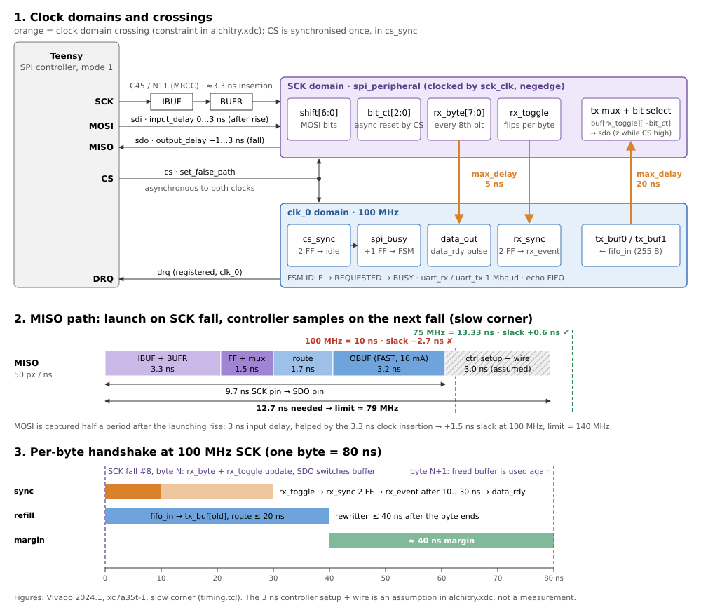

# Timing and data flow

How data moves between the Teensy, the SCK domain and the 100 MHz domain,
and which constraint in [`../constraint/alchitry.xdc`](../constraint/alchitry.xdc)
covers each path. The figures come from `timing.tcl` (Vivado 2024.1,
xc7a35t-1, slow corner); see the README for how to run it.



## 1. Clock domains and crossings

```
          Teensy (SPI controller, mode 1)                         FPGA (xc7a35t)
 ┌──────────────────────────┐
 │                          │   SCK (C45/N11, MRCC)  ┌──────┐ ┌──────┐
 │  SCK  ───────────────────┼───────────────────────►│ IBUF ├►│ BUFR ├──► sck_clk  (~3.3 ns insertion)
 │                          │                        └──────┘ └──────┘        │
 │                          │                                                 ▼
 │                          │        ╔══════════════ SCK domain (spi_peripheral) ═════════════╗
 │  MOSI ───────────────────┼─sdi──► ║ negedge: shift[6:0] ─► rx_byte[7:0]                     ║
 │  (changes on rise)       │        ║          bit_ct[2:0] (async reset by CS)                ║
 │                          │        ║          rx_toggle (flips every 8th bit)                ║
 │  MISO ◄──────────────────┼─sdo─── ║ sdo = cs ? z : (rx_toggle ? tx_buf1 : tx_buf0)[~bit_ct] ║
 │  (sampled on fall)       │        ╚═══▲═══════════════▲══════════════│══════════│═══════════╝
 │                          │            │ tx_buf0/1     │ cs           │ rx_toggle│ rx_byte
 │  CS ─────────────────────┼────────────┼───────────────┤              │          │
 │                          │            │ max_delay     │ false_path   │ max_delay 5 ns
 │  DRQ ◄───────────┐       │            │ 20 ns         │              │ (datapath only)
 └──────────────────┼───────┘        ╔═══╧═══════════════▼══════════════▼══════════▼═══════════╗
                    │                ║ clk_0 domain, 100 MHz (spi_buffer + alchitry_top)       ║
                    │                ║   cs_sync[1:0] (2FF) ─► idle                            ║
                    │                ║   idle ─► spi_busy (+1 FF, alchitry_top) ─► FSM         ║
                    │                ║   rx_sync[1:0] (2FF) ─► rx_event = rx_sync[1] != cur    ║
                    │                ║   rx_event: data_out <= rx_byte, refill tx_buf[cur]     ║
                    │                ║   fifo_in (255 B) ─► tx_buf0 / tx_buf1                  ║
                    └────────────────╫── drq_reg ◄── state machine IDLE/REQUESTED/BUSY         ║
                                     ║   uart_rx / uart_tx @ 1 Mbaud ◄─► echo FIFO             ║
                                     ╚═════════════════════════════════════════════════════════╝
```

## 2. MISO: the path that limits the rate

Launched on a falling SCK edge, sampled by the controller on the next falling
edge, so the budget is one full SCK period.

```
 SCK fall ──► IBUF+BUFR ──► FF (bit_ct / rx_toggle) ──► mux tx[~bit_ct] ──► route ──► OBUF ──► pin ──► controller setup + wire
              3.3 ns         ├──────── 1.5 ns ───────────────┤             1.7 ns    3.2 ns           3.0 ns (output_delay -max)
 ├──────────────────────────────────── 9.7 ns pin to pin ────────────────────────────────────┤
 ├──────────────────────────────────────────────── 12.7 ns needed ──────────────────────────────────────────────────┤

 budget = 1 SCK period:   75 MHz = 13.33 ns  → slack ≈ +0.6 ns  ✔
                         100 MHz = 10.00 ns  → slack ≈ −2.7 ns  ✘     limit ≈ 1 / 12.7 ns ≈ 79 MHz
```

The 3 ns for controller setup plus wire is an assumption in `alchitry.xdc`,
not a measured value.

## 3. MOSI

Launched on the rising edge, captured on the falling edge half a period later.

```
 SCK   ‾‾‾‾\____/‾‾‾‾\____/‾‾‾‾
           ▲rise      ▼fall (capture in shift / rx_byte)
 MOSI  ──X═══════════X────        input_delay −max 3.0 / −min 0.0 relative to the rising edge
       ├─ 3 ns ─┤ data path ─┤    budget = ½ period (5 ns at 100 MHz), helped by the 3.3 ns clock insertion
                                  slack ≈ +1.5 ns at 100 MHz → limit ≈ 140 MHz
```

## 4. Clock domain crossing per byte (100 MHz SCK, one byte = 80 ns)

```
 SCK fall #8 of byte N
   │  rx_byte updated, rx_toggle flips  ──(≤5 ns route)──►  rx_sync[0] ─► rx_sync[1]       (10–30 ns)
   │  SDO switches to the other buffer                              │
   │                                                                ▼ rx_event (1 clk_0 cycle)
   │                                    data_out <= rx_byte, data_rdy pulse, cur <= ~cur
   │                                    tx_buf[old] <= fifo_in (or 0xFF if empty or starved)
   │                                        └──(≤20 ns route, max_delay)──► SCK domain
   │                                    total: rewritten ≤ ~40 ns after the byte ends
   ▼
 SCK fall #8 of byte N+1  (80 ns later): the rewritten buffer is selected again → ~40 ns margin
```

## Constraints and the paths they cover

| Path                          | Constraint                                | What it protects                                         |
| ----------------------------- | ----------------------------------------- | -------------------------------------------------------- |
| sdi → shift / rx_byte         | `set_input_delay` 0…3 ns                  | MOSI capture                                             |
| bit_ct / rx_toggle → sdo      | `set_output_delay -clock_fall` −1…3 ns    | MISO (limits the rate)                                   |
| rx_byte, rx_toggle → clk_0    | `set_max_delay -datapath_only 5`          | rx_byte has settled before the synchronised toggle      |
| tx_buf0/1 → sdo mux           | `set_max_delay -datapath_only 20`         | a buffer is refilled before it is used again             |
| cs → everything               | `set_false_path`                          | asynchronous; handled by synchronisers, the async reset and protocol margin |

## CS in alchitry_top

CS is synchronised once, in `spi_buffer` (`cs_sync`, 2 FF), and that
synchronised value is an output (`idle`). The state machine in
`alchitry_top` uses it through one more register:

```
 cs ──► cs_sync[0] ─► cs_sync[1] = idle ─► spi_busy ─► state machine     (3 clocks)
 rx_toggle ──► rx_sync[0] ─► rx_sync[1] ─► rx_pending ─► state machine   (2 clocks)
                                           (rx_event)    data_rdy follows 1 clock later
```

BUSY → IDLE needs `!spi_busy && !spi_rx_pending`. CS rises after the last
SCK edge, and its path is one register longer than rx_toggle's, so a byte
that completes at the last moment is pending before the state machine sees
CS high. It stays in BUSY until `data_rdy` has gone into the echo FIFO.
`a_rx_before_idle` in the testbench checks this: `rx_pending` may never be
high when `idle` was already high two clocks earlier.

Earlier, `alchitry_top` sampled CS with its own single flip-flop
(`spi_busy <= ~cs`). That had two problems:

- A metastable `spi_busy` feeds both `spi_state` bits, and REQUESTED (01) →
  BUSY (10) changes both, so the state machine could end up in IDLE with DRQ
  still high. Unlikely with ~10 ns to resolve, but not reported by timing
  because CS is a false path.
- It saw CS rise before the last byte's `data_rdy` (1 FF against 2 FF + 1
  register), so with hardware CS the last byte wasn't echoed.
